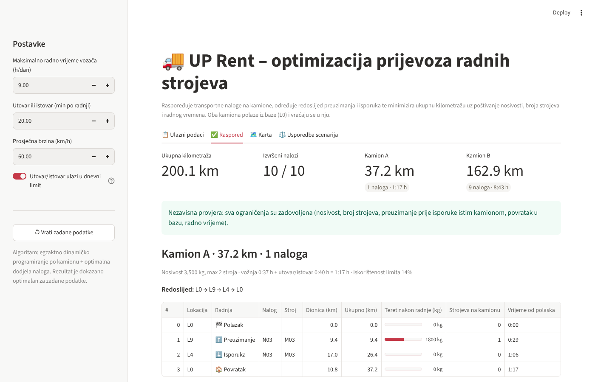

# UP Rent – optimizacija prijevoza radnih strojeva

Prototip web aplikacije koja raspoređuje transportne naloge na dva kamiona, određuje
redoslijed preuzimanja i isporuka i minimizira ukupnu kilometražu, uz poštivanje
nosivosti, broja strojeva, dnevnog radnog vremena i obaveznog povratka u bazu.

**Rezultat za zadane podatke: svih 10 naloga, ukupno 200,1 km** (Kamion A 37,2 km,
Kamion B 162,9 km), oba vozača unutar 9 h. Rješenje je **dokazano optimalno**
(egzaktni algoritam, neovisno potvrđeno OR-Toolsom i brute-force testom).



---

## 1. Pokretanje

Potrebno: Python 3.10+

```bash
git clone https://github.com/iburic55/uprent-transport-optimizer.git
cd uprent-transport-optimizer
pip install -r requirements.txt

streamlit run app.py          # web aplikacija -> http://localhost:8501
pytest -v                     # testovi poslovnih ograničenja
python -m optimizer           # isti raspored ispisan u terminalu
```

Opcionalna neovisna provjera s Google OR-Toolsom:

```bash
pip install ortools
python tools/verify_ortools.py
```

## 2. Što aplikacija radi

| Zahtjev iz zadatka | Gdje / kako |
|---|---|
| Prikaz i pregled ulaznih podataka | Kartica **Ulazni podaci**: vozni park, strojevi, lokacije, nalozi. Tablice se mogu uređivati, a raspored se odmah ponovno izračunava. |
| Automatska dodjela naloga kamionima | Optimizator bira najbolju podjelu (sve kombinacije) |
| Redoslijed obilaska | Kartica **Raspored**: redoslijed lokacija + tablica radnji |
| Nosivost i broj strojeva u svakom trenutku | Ugrađeno u algoritam; nedopuštena stanja se ni ne generiraju |
| Preuzimanje prije isporuke, isti kamion | Ugrađeno u model stanja (čeka → na kamionu → isporučen) |
| Minimalna kilometraža | Egzaktna optimizacija |
| Kilometraža po kamionu i ukupno | Metrike na vrhu kartice Raspored |
| Upozorenje za neizvršive naloge | Crveni okvir s popisom naloga i razlogom (preteško / nema vremena) |
| Radnje i opterećenje nakon svake radnje | Tablica po kamionu: lokacija, radnja, nalog, stroj, km, teret, broj strojeva, vrijeme |
| Broj izvršenih naloga | Metrike i naslov svakog kamiona |
| Karta (opcionalno) | Kartica **Karta**: rute s označenim smjerom |
| Dodatno | Kartica **Usporedba scenarija**; nezavisna provjera plana (zeleni/crveni status) |

U bočnoj traci mogu se mijenjati radno vrijeme, trajanje utovara/istovara, brzina i
tumačenje dnevnog limita.

## 3. Optimizacijska logika

Problem je **Pickup and Delivery Vehicle Routing Problem** s kapacitetom
(kg i broj strojeva) i vremenskim ograničenjem. Općenito je NP-težak, ali za ovu
veličinu (10 naloga, 2 kamiona) može se riješiti **egzaktno**, pa sam umjesto
heuristike odabrao algoritam koji jamči optimum.

**Korak 1 – optimalna ruta za svaki kamion i svaki podskup naloga (dinamičko programiranje).**
Stanje = status svakog naloga (0 = čeka, 1 = na kamionu, 2 = isporučen) + trenutna lokacija.
Iz stanja se smije samo:
- **preuzeti** nalog koji čeka, ako stroj stane po težini i broju mjesta;
- **isporučiti** nalog koji je na kamionu.

Zato nosivost i redoslijed preuzimanje → isporuka *ne mogu* biti prekršeni. Svaki korak
povećava zbroj statusa za 1, pa se stanja obrađuju po razinama i za svako se pamti najkraći
put. Kad je kamion prazan, ruta se zatvori povratkom u bazu. Tako za **svaki** podskup naloga
dobijemo najkraću rutu baza → … → baza. Zbog kapaciteta (najviše 2 odnosno 3 stroja)
dostižnih stanja ima malo, pa izračun traje oko 0,2 s.

**Korak 2 – podjela između kamiona.** Kamion A smije voziti samo strojeve ≤ 3.500 kg
(N01–N05), kamion B sve. Od svih parova *disjunktnih* podskupova koji stanu u radno
vrijeme bira se onaj s:
1. **najviše izvršenih naloga** (prioritet: ništa ne ostaje neisporučeno), zatim
2. **najmanjom ukupnom kilometražom**.

Nalozi koji ne stanu označe se kao neizvršivi, s razlogom.

**Pravila izračuna**
- Udaljenost: euklidska, zaokružena na 0,1 km **po dionici**. Interno se računa u
  desetinkama km (cijeli brojevi), pa se zaokruživanje ne gomila.
- Vrijeme: vožnja = km / 60 km/h; svaki utovar i svaki istovar traje 20 min.
- **Pretpostavka:** u dnevni limit od 9 h ulazi vožnja **i** utovar/istovar, jer je to
  stvarno radno vrijeme vozača i konzervativnija varijanta. U aplikaciji se može prebaciti
  na „samo vožnja”.
- Više radnji na istoj lokaciji (npr. istovar pa utovar na L8) ne dodaje kilometre.

### Ključni uvid

| Scenarij | Ukupno | Raspored |
|---|---|---|
| Bez vremenskog limita (teoretski minimum) | **182,2 km** | Sve vozi kamion B, ali to traje **9 h 42 min** |
| Limit 9 h, samo vožnja | 182,2 km | Isto kao gore (vožnja je samo ~3 h) |
| **Limit 9 h, vožnja + utovar/istovar (zadano)** | **200,1 km** | A: N03 (1 h 17 min), B: ostalih 9 naloga (8 h 43 min) |

Najkraća kilometraža zahtijevala bi da jedan vozač radi 42 minute preko limita. Optimizator
zato prebacuje nalog N03 (L9 → L4) na kamion A. To je najjeftinija preraspodjela
(+17,9 km), nakon koje oba vozača završavaju na vrijeme. Zanimljiv je i rad kamiona B:
M04 preuzima na L3 i nosi ga do baze, a usput odradi M08 i M09 (vrhunac tereta
9.900 / 10.000 kg).

## 4. Testovi

`pytest -v` pokreće 16 testova u `tests/test_constraints.py`, među ostalim:

- nosivost i broj strojeva nikad nisu prekoračeni ni nakon jedne radnje;
- strojevi teži od 3.500 kg nikad ne idu kamionom A; M10 uvijek putuje sam;
- svaki stroj preuzima i isporučuje isti kamion, i to preuzimanje dolazi prvo;
- obje rute počinju i završavaju u bazi, prazne;
- radno vrijeme ≤ 9 h; uz kraći limit (3 h) neizvršivi nalozi se jasno označe;
- preteški stroj (12 t) odbija se s razlogom, a ostali nalozi se i dalje izvrše;
- **validator stvarno hvata greške** (namjerno pokvaren plan: prekoračena nosivost,
  isporuka prije preuzimanja);
- **optimalnost:** rezultat DP-a jednak je brute-forceu (sve permutacije radnji) na manjim
  primjerima.

Sve se provjerava i neovisnim validatorom (`optimizer/validate.py`), koji iz samog niza
radnji ponovno izračuna kilometre, teret, vrijeme i redoslijed. Isti validator koristi i
aplikacija za zeleni/crveni status.

## 5. Struktura

```
app.py                    Streamlit web sučelje
optimizer/data.py         ulazni podaci zadatka
optimizer/solver.py       optimizacijski algoritam
optimizer/validate.py     nezavisna provjera ograničenja
optimizer/__main__.py     ispis u terminalu
tests/test_constraints.py testovi poslovnih ograničenja
tools/verify_ortools.py   neovisna usporedba s Google OR-Toolsom
```

**Tehnologije:** Python (jednostavan za optimizaciju i provjeru), Streamlit (brz razvoj
funkcionalnog web sučelja bez zasebnog frontenda), Plotly (karta), pytest. Za vlastiti
algoritam nisu potrebne vanjske optimizacijske biblioteke; OR-Tools služi samo za provjeru.

## 6. Korištenje AI alata i provjera rezultata

Za razvoj sam koristio **Claude (Anthropic)**: za analizu problema, prijedlog pristupa,
pisanje koda, testova i ove dokumentacije. Ni jednom rezultatu AI-ja nisam vjerovao bez provjere:

1. **Neovisna usporedba s OR-Toolsom.** Isti problem modeliran je u Googleovom solveru i dao
   je istu kilometražu (200,1 km i 182,2 km) za oba tumačenja limita.
2. **Brute force.** Na manjim primjerima isprobane su *sve* permutacije radnji; DP daje isti
   optimum.
3. **Nezavisni validator.** Odvojen kod ponovno računa sva ograničenja i namjerno je testiran
   na pokvarenim planovima kako bi se vidjelo da stvarno javlja greške.
4. **Ručna provjera.** Ruta kamiona A izračunata je na papiru:
   √89 ≈ 9,4 + √290 ≈ 17,0 + √117 ≈ 10,8 = 37,2 km; vrijeme 37 min vožnje + 2 × 20 min = 1 h 17 min.
5. **Kritičko čitanje testova.** Prvi test „M10 putuje sam” bio je pogrešno napisan
   (gledao je ukupni teret ≥ 9.400 kg, a to može biti i M09 + M04). Test je pao, a ja sam
   utvrdio da je greška u testu, ne u algoritmu, i ispravio ga da gleda koji su strojevi
   stvarno na kamionu.
6. **Tumačenje zadatka.** Nejasnoću oko toga ulazi li utovar/istovar u 9 h nisam prepustio
   AI-ju da prešutno odluči; izložena je kao pretpostavka i prekidač u aplikaciji.

## 7. Procjena utrošenog vremena

| Aktivnost | Vrijeme |
|---|---|
| Analiza zadatka i odabir pristupa | 0,5 h |
| Optimizator i validator | 1 h |
| Web sučelje | 1 h |
| Testovi i neovisne provjere (OR-Tools, brute force, ručno) | 1 h |
| Dokumentacija | 0,5 h |
| **Ukupno** | **~4 h** |

## 8. Ograničenja i mogući nastavak

- Egzaktni DP praktičan je do ~12 naloga po kamionu. Za stvarni dnevni volumen UP Renta
  prebacio bih se na OR-Tools/heuristiku (model je već napisan u `tools/verify_ortools.py`).
- Prema zadatku koriste se euklidske udaljenosti; za produkciju trebaju stvarne ceste
  (OSRM/Google Distance Matrix) i vremenski prozori kupaca.
- Planiranje na više dana, prioriteti naloga, vozač bez kamiona i slično nisu dio zadatka.
