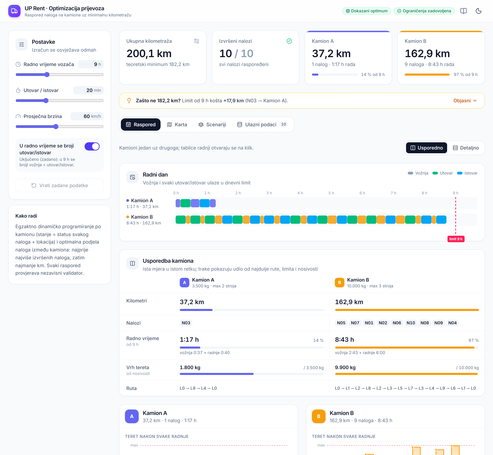
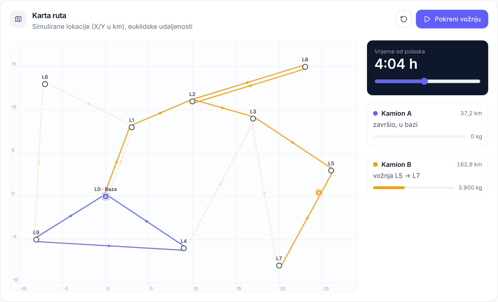

# UP Rent – optimizacija prijevoza radnih strojeva

Prototip web aplikacije koja raspoređuje transportne naloge na dva kamiona, određuje
redoslijed preuzimanja i isporuka i minimizira ukupnu kilometražu, uz poštivanje
nosivosti, broja strojeva, dnevnog radnog vremena i obaveznog povratka u bazu.

**Rezultat za zadane podatke: svih 10 naloga, ukupno 200,1 km** (Kamion A 37,2 km,
Kamion B 162,9 km), oba vozača unutar 9 h. Rješenje je **dokazano optimalno**
(egzaktni algoritam, neovisno potvrđeno OR-Toolsom i brute-force testom).

### ⚠️ Zamka u zadatku

Najkraći mogući raspored ima **182,2 km**: sve naloge vozi kamion B, a kamion A ostaje u bazi.
Vožnja tada traje samo 3 h 2 min, ali 10 naloga znači 20 radnji × 20 min = 6 h 40 min
utovara/istovara, ukupno **9 h 42 min**, što je preko dnevnog limita od 9 h. Optimizator zato
nalog **N03 (L9 → L4) daje kamionu A** (+17,9 km), pa oba vozača završavaju na vrijeme
(1 h 17 min i 8 h 43 min). Pretpostavka da utovar/istovar ulazi u 9 h izložena je kao prekidač
u aplikaciji. Ako se računa samo vožnja, dopušteno je 182,2 km (vidi [Ključni uvid](#ključni-uvid)).
Aplikacija to objašnjava u traci **„Zašto ne 182,2 km?”** na vrhu stranice.

Manje zamke:
- kamion A ne smije voziti M06–M10 (> 3.500 kg), a M01 + M05 = 3.900 kg ne stane ni u 2 mjesta;
- M10 (9.400 kg) uvijek putuje sam;
- baza je i lokacija naloga (N05 se preuzima u L0, N04 isporučuje u L0);
- udaljenost se zaokružuje po dionici, ne tek ukupni zbroj;
- uz zadane podatke **nijedan nalog nije neizvršiv**; upozorenje se vidi tek uz strože uvjete
  (npr. limit od 4 h → N06, N08, N10).



## Sadržaj predaje

| Traženo u zadatku (točka 8) | Gdje se nalazi |
|---|---|
| Izvorni kod aplikacije | Ovaj repozitorij (struktura u odjeljku [5](#5-struktura)) |
| Kratke upute za pokretanje | [1. Pokretanje](#1-pokretanje) |
| Funkcionalna demonstracija | [2. Funkcionalna demonstracija](#2-funkcionalna-demonstracija) |
| Kratak opis optimizacijske logike | [3. Optimizacijska logika](#3-optimizacijska-logika) |
| Najmanje tri testa poslovnih ograničenja | [4. Testovi](#4-testovi): 32 testa (`tests/test_constraints.py`, `tests/test_api.py`) |
| Osvrt na AI alate i provjeru rezultata | [6. Korištenje AI alata](#6-korištenje-ai-alata-i-provjera-rezultata) |
| Procjena stvarnog vremena razvoja | [7. Procjena utrošenog vremena](#7-procjena-utrošenog-vremena): **~6 h** (zadatak ~5 h + dorade ~1 h) |

---

## 1. Pokretanje

Potrebno: **Python 3.10+** i **Node.js 20+**.

```bash
git clone https://github.com/iburic55/uprent-transport-optimizer.git
cd uprent-transport-optimizer
python -m venv .venv          # preporučeno: zasebno okruženje
.venv\Scripts\activate        # Windows (Linux/macOS: source .venv/bin/activate)
pip install -r requirements.txt

# React sučelje (jednom): izgradnja frontenda
cd frontend && npm install && npm run build && cd ..

uvicorn api.main:app          # aplikacija + API -> http://localhost:8000  (API docs: /docs)
pytest -v                     # testovi poslovnih ograničenja i API-ja
python -m optimizer           # isti raspored ispisan u terminalu
```

Razvojni način (automatsko osvježavanje): `uvicorn api.main:app --reload` u jednom terminalu i
`cd frontend && npm run dev` u drugom → http://localhost:5173 (Vite prosljeđuje `/api` na 8000).

**Rezervno sučelje bez Node.js-a:** `streamlit run app.py` → http://localhost:8501 (iste
funkcionalnosti, isti optimizator).

Opcionalna neovisna provjera s Google OR-Toolsom:

```bash
pip install ortools
python tools/verify_ortools.py
```

## 2. Funkcionalna demonstracija

🎬 **Video demonstracija (5:53, bez zvuka):** [`docs/demo.mp4`](docs/demo.mp4). Svaki od 35
koraka (klik, unos, pokazivanje) ima titl na hrvatskom: **što se radi** i **zašto / što se vidi**,
uz oznaku radnje kraj kursora i brojač koraka. Titlovi su i zasebno u [`docs/demo.srt`](docs/demo.srt)
te kao isključiva titlovna traka u MP4. Video je snimljen automatski skriptom
`tools/record_demo.js` (Playwright), pa se nakon izmjena može ponovno snimiti.

Nakon `uvicorn api.main:app` aplikacija se otvara na http://localhost:8000. Za demonstraciju
predlažem ovaj redoslijed (oko 3 minute):

1. **Vrh stranice:** ukupno 200,1 km, 10/10 naloga, oznake „Dokazani optimum” i „Ograničenja
   zadovoljena”, te traka **„Zašto ne 182,2 km?”** (zamka s 9 h); „Objasni” otvara puno objašnjenje.
2. **Raspored:** vremenska crta radnog dana s crtom limita od 9 h i **usporedba kamiona** jedan uz
   drugoga (km, nalozi, radno vrijeme prema limitu, vrh tereta prema nosivosti, ruta), ispod
   koje su grafovi tereta i tablice radnji na klik. Prekidač „Detaljno” prikazuje svaki kamion
   u punoj širini (teret i broj strojeva nakon svake radnje, vrijeme).
3. **Karta:** gumb „Pokreni vožnju” animira oba kamiona po stvarnoj vremenskoj crti, uz trenutnu
   radnju i teret.
4. **Scenariji:** usporedba tumačenja limita (200,1 / 182,2 / 182,2 km).
5. **Neizvršivi nalozi uživo:** radno vrijeme na 4 h → 7 naloga, a za N06, N08 i N10 crveno
   ispiše razlog.
6. **Ulazni podaci:** promjena nosivosti ili naloga, a raspored se odmah ponovno izračuna.
   Neispravan unos (npr. dupli nalog) jasno se odbije. Tamna tema: ikona mjeseca gore desno.



Streamlit verzija (`streamlit run app.py`) ima iste funkcije; njezine snimke su u
`docs/raspored.png` i `docs/karta.png`.

## 2a. Što aplikacija radi

| Zahtjev iz zadatka | Gdje / kako |
|---|---|
| Prikaz i pregled ulaznih podataka | Kartica **Ulazni podaci**: vozni park, strojevi, lokacije, nalozi. Tablice se mogu uređivati, a raspored se odmah ponovno izračunava. |
| Automatska dodjela naloga kamionima | Optimizator bira najbolju podjelu (sve kombinacije) |
| Redoslijed obilaska | Kartica **Raspored**: usporedba kamiona (ruta), graf tereta + tablica radnji |
| Nosivost i broj strojeva u svakom trenutku | Ugrađeno u algoritam; nedopuštena stanja se ni ne generiraju |
| Preuzimanje prije isporuke, isti kamion | Ugrađeno u model stanja (čeka → na kamionu → isporučen) |
| Minimalna kilometraža | Egzaktna optimizacija |
| Kilometraža po kamionu i ukupno | Kartice na vrhu stranice i tablica **Usporedba kamiona** |
| Upozorenje za neizvršive naloge | Crveni okvir s popisom naloga i razlogom po kamionu (npr. „Kamion A: stroj je pretežak; Kamion B: radio bi 5 h 15 min”) |
| Neispravni ulazni podaci | Provjera prije izračuna (`check_inputs`): duple oznake, težina/nosivost ≤ 0, ista lokacija preuzimanja i isporuke, nedostaje baza – jasna poruka umjesto pada aplikacije |
| Radnje i opterećenje nakon svake radnje | Tablica po kamionu: lokacija, radnja, nalog, stroj, km, teret, broj strojeva, vrijeme |
| Broj izvršenih naloga | Metrike i naslov svakog kamiona |
| Karta (opcionalno) | Kartica **Karta**: rute s označenim smjerom |
| Dodatno | Kartica **Scenariji** (usporedba tumačenja limita); nezavisna provjera plana (zeleni/crveni status) |

U bočnoj traci mogu se mijenjati radno vrijeme, trajanje utovara/istovara, brzina i
tumačenje dnevnog limita.

## 3. Optimizacijska logika

**Ukratko:** problem je *Pickup and Delivery Vehicle Routing Problem* s kapacitetom (kg i broj
strojeva) i vremenskim limitom. Za 10 naloga i 2 kamiona rješava se **egzaktno** u dva koraka,
pa je rezultat dokazani optimum (potvrđen OR-Toolsom i brute forceom), a ne procjena.

**Korak 1 – najbolja ruta po kamionu (dinamičko programiranje).** Stanje = koji su nalozi na
kamionu, koji su isporučeni i gdje je kamion. Iz stanja se smije samo *preuzeti* nalog koji
stane po težini i broju mjesta ili *isporučiti* nalog koji je na kamionu, pa nosivost i
redoslijed preuzimanje → isporuka ne mogu biti prekršeni. Za svako stanje pamti se najkraći put,
a stanja koja više ne stanu u radno vrijeme odmah se odbacuju. Rezultat je najkraća ruta
baza → … → baza za **svaki** podskup naloga (oko 0,2 s).

**Korak 2 – podjela naloga.** Kamion A smije voziti samo strojeve ≤ 3.500 kg (N01–N05), kamion B
sve. Od svih podjela bez preklapanja bira se ona s **najviše izvršenih naloga**, a zatim s
**najmanje kilometara**. Nalog koji ne stane označi se kao neizvršiv, s razlogom za svaki kamion.

**Pravila izračuna:** euklidska udaljenost zaokružena na 0,1 km **po dionici** (računa se u
desetinkama km kao cijelim brojevima); vožnja 60 km/h; svaki utovar i istovar 20 min.
**Pretpostavka:** u 9 h ulazi vožnja **i** utovar/istovar (stvarno radno vrijeme vozača);
drugo tumačenje dostupno je kao prekidač.

**Veći problemi:** ako kamion ima više od 12 mogućih naloga, DP postaje prespor, pa se koristi
heuristika (najjeftinije umetanje + lokalna pretraga, `optimizer/heuristic.py`) uz jasno
upozorenje da raspored nije dokazano optimalan.

### Ključni uvid

| Scenarij | Ukupno | Raspored |
|---|---|---|
| Bez vremenskog limita (teoretski minimum) | **182,2 km** | Sve vozi kamion B, ali to traje **9 h 42 min** |
| Limit 9 h, samo vožnja | 182,2 km | Isto kao gore (vožnja je samo ~3 h) |
| **Limit 9 h, vožnja + utovar/istovar (zadano)** | **200,1 km** | A: N03 (1 h 17 min), B: ostalih 9 naloga (8 h 43 min) |

Prebacivanje naloga N03 (L9 → L4) na kamion A najjeftinija je preraspodjela (+17,9 km) nakon
koje oba vozača završavaju unutar 9 h.

## 4. Testovi

`pytest -v` pokreće 32 testa: 27 u `tests/test_constraints.py` i 5 u `tests/test_api.py`
(optimum i zamka preko API-ja, vremenska crta, neispravan unos, limit od 4 h, validacija postavki).
Među ostalim:

- nosivost i broj strojeva nikad nisu prekoračeni ni nakon jedne radnje;
- strojevi teži od 3.500 kg nikad ne idu kamionom A; M10 uvijek putuje sam;
- svaki stroj preuzima i isporučuje isti kamion, i to preuzimanje dolazi prvo;
- obje rute počinju i završavaju u bazi, prazne;
- radno vrijeme ≤ 9 h; uz kraći limit neizvršivi nalozi se jasno označe s razlogom
  (uz 4 h točno N06, N08 i N10, kao u demonstraciji), i to po kamionu: Kamion A – stroj
  pretežak, Kamion B – uz svoje naloge radio bi preko 4 h;
- preteški stroj (12 t) odbija se s razlogom, a ostali nalozi se i dalje izvrše;
- **validator stvarno hvata greške** (namjerno pokvaren plan: prekoračena nosivost,
  isporuka prije preuzimanja, krivo prikazan teret u tablici);
- neispravni ulazni podaci (dupla oznaka naloga, težina 0, ista lokacija preuzimanja i
  isporuke, kamion bez nosivosti, nedostaje baza) odbijaju se jasnom porukom;
- rubni slučajevi: nema vozila, scenarij „bez ograničenja” uz malu brzinu, više od 12 naloga
  po kamionu (heuristika poštuje sva ograničenja), validator ne pada na nepoznat nalog;
- **optimalnost:** rezultat DP-a jednak je brute-forceu (sve permutacije radnji) na manjim
  primjerima.

Sve se provjerava i neovisnim validatorom (`optimizer/validate.py`), koji iz samog niza
radnji ponovno izračuna kilometre, teret, vrijeme i redoslijed. Isti validator koristi i
aplikacija za zeleni/crveni status.

## 5. Struktura

```
api/main.py               FastAPI: /api/defaults, /api/optimize (+ poslužuje izgrađeni frontend)
frontend/                 React + TypeScript sučelje (Vite, Tailwind CSS, Motion)
app.py                    Streamlit sučelje (rezervno, bez Node.js-a)
optimizer/insight.py      objašnjenje zamke (zajedničko za oba sučelja)
optimizer/data.py         ulazni podaci zadatka i provjera ulaza
optimizer/solver.py       optimizacijski algoritam (egzaktni DP + optimalna podjela)
optimizer/heuristic.py    heuristika za veće probleme (umetanje + lokalna pretraga)
optimizer/validate.py     nezavisna provjera ograničenja
optimizer/__main__.py     ispis u terminalu
tests/test_constraints.py testovi poslovnih ograničenja
tests/test_api.py         testovi REST API-ja
tools/verify_ortools.py   neovisna usporedba s Google OR-Toolsom
tools/record_demo.js      automatsko snimanje demonstracijskog videa (Playwright)
```

**Tehnologije**
- **Backend:** Python (optimizacija i provjera), FastAPI (tipizirani REST API s automatskom
  dokumentacijom na `/docs`), pytest. Za vlastiti algoritam nisu potrebne vanjske optimizacijske
  biblioteke; OR-Tools služi samo za provjeru.
- **Frontend:** React 19 + TypeScript (strogi tipovi), Vite, Tailwind CSS 4, TanStack Query
  (ponovni izračun s debounceom, bez treperenja), Motion (animacije), Lucide ikone. Karta,
  vremenska crta i graf tereta su vlastiti SVG (lokacije su X/Y u km, a ne GPS, pa kartografske
  biblioteke nemaju smisla). Svijetla/tamna tema, prilagođeno mobitelu.
- Frontend ne računa ništa poslovno: sve brojke dolaze iz istog optimizatora i validatora, pa
  oba sučelja daju identične rezultate.
- **Streamlit** ostaje kao rezervno sučelje koje se pokreće jednom naredbom bez Node.js-a.

## 6. Korištenje AI alata i provjera rezultata

Koristio sam **Claude (Anthropic)** za analizu problema, prijedlog pristupa te pisanje koda,
testova i dokumentacije. Nijednom rezultatu nisam vjerovao bez neovisne provjere:

1. **OR-Tools:** isti problem riješen Googleovim solverom daje istih 200,1 km (i 182,2 km za
   drugo tumačenje limita).
2. **Brute force:** na manjim primjerima isprobane su sve permutacije radnji; DP daje isti optimum.
3. **Nezavisni validator:** odvojen kod iz niza radnji ponovno računa sva ograničenja, a testiran
   je i na namjerno pokvarenim planovima.
4. **Ručni izračun:** ruta kamiona A je 9,4 + 17,0 + 10,8 = 37,2 km; 37 min vožnje + 2 × 20 min
   = 1 h 17 min.
5. **Testovi u pregledniku (Playwright):** klikovi i unos u stvarnom sučelju, desktop i mobitel.
6. **Kritičko čitanje:** nejasnoću oko 9 h nisam prepustio AI-ju, nego sam je izložio kao
   pretpostavku i prekidač; testove sam čitao jednako kritički kao kod.

Provjere su pronašle stvarne greške koje sam ispravio: krivo napisan test „M10 putuje sam”,
gubljenje druge izmjene u Streamlit tablici, pad aplikacije za više od 12 naloga po kamionu
(sada heuristika) i polje za radno vrijeme koje nije primalo novi upis.

## 7. Procjena utrošenog vremena

**Ukupno ~6 h**, u skladu s predviđenim trajanjem zadatka: sam zadatak ~5 h, a dorade nakon
vlastitog pregleda ~1 h.

| Aktivnost | Vrijeme |
|---|---|
| Analiza zadatka i prototip: optimizator (DP), validator, testovi, Streamlit sučelje | 1,5 h |
| Završni i tehnički pregled: bugovi, rubni slučajevi, provjera ulaza, heuristika, ubrzanje DP-a | 1,5 h |
| React + FastAPI sučelje i video demonstracija | 1,5 h |
| Dokumentacija i završna provjera na čistom klonu | 0,5 h |
| *Zadatak ukupno* | *~5 h* |
| Dorade nakon pregleda: razlog po kamionu, usporedba kamiona, polje za vrijeme, prekidač, sažeta traka, novi video | ~1 h |
| **Ukupno** | **~6 h** |

## 8. Ograničenja i mogući nastavak

- Egzaktni DP praktičan je do ~12 naloga po kamionu; iznad toga radi ugrađena heuristika.
  Za stvarni dnevni volumen UP Renta koristio bih OR-Tools (model je već napisan u
  `tools/verify_ortools.py`) ili jaču metaheuristiku (npr. ALNS).
- Prema zadatku koriste se euklidske udaljenosti; za produkciju trebaju stvarne ceste
  (OSRM/Google Distance Matrix) i vremenski prozori kupaca.
- Planiranje na više dana, prioriteti naloga, vozač bez kamiona i slično nisu dio zadatka.
